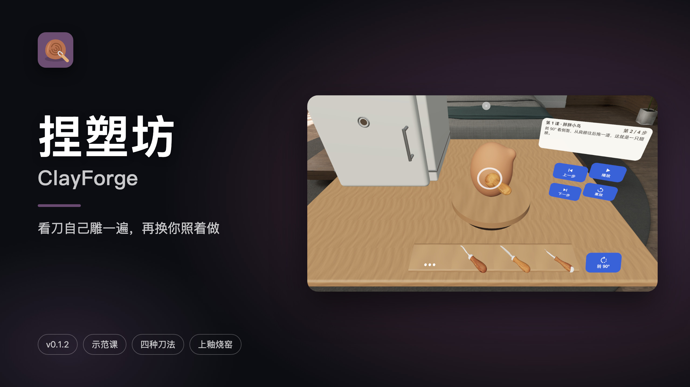
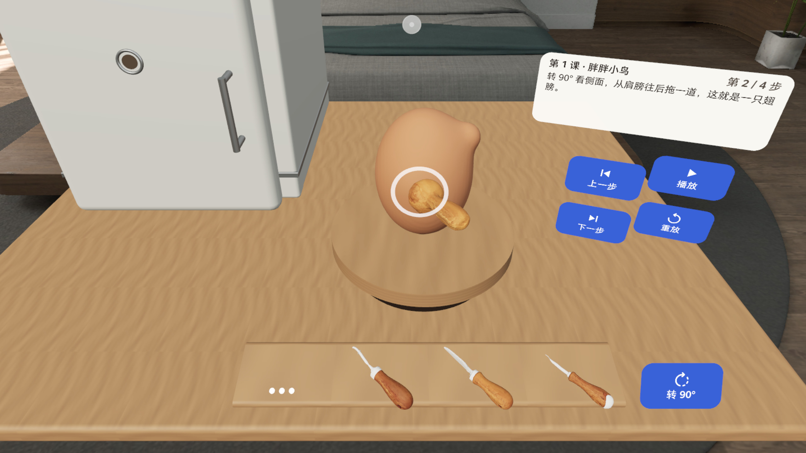
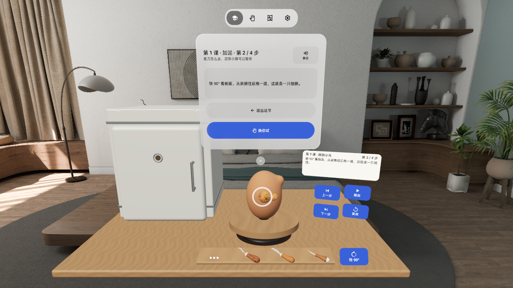
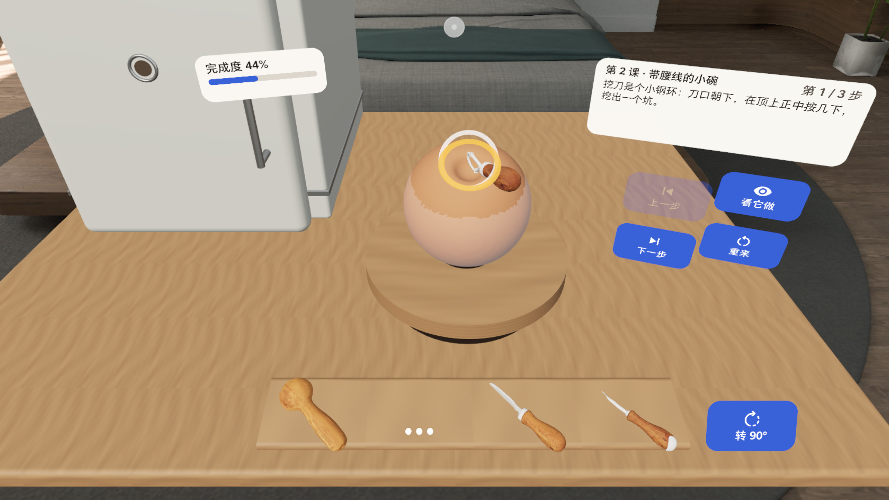
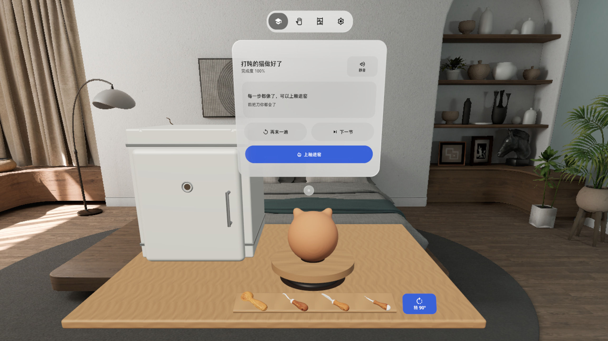
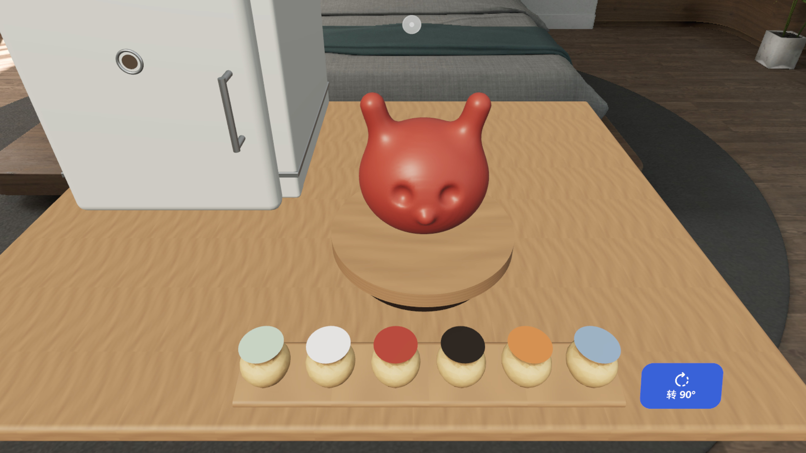
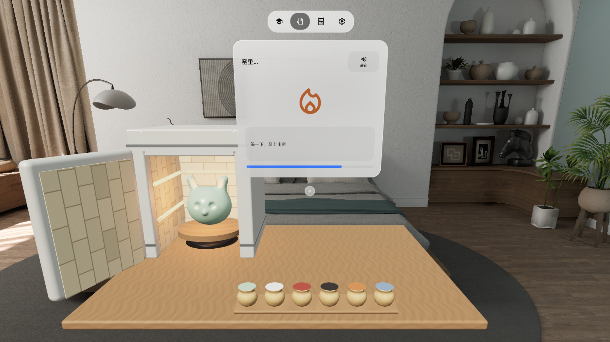
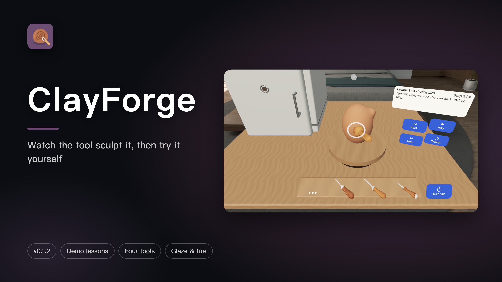

# 捏塑坊 ClayForge



**中文** · [English](#english)

PICO OS 6 Full Space（混合现实）应用。工作台按桌子的高度摆在你面前，转盘上一团陶泥，托盘里四把小刀，旁边一台小电窑。
不会捏也没关系：先看刀自己在泥上雕一遍，再换你照着做。

- **4 节示范课**：胖胖小鸟（加泥）、带腰线的小碗（挖）、圆角石头镇纸（抹平）、打盹的猫（拉），每节 3–4 步、大约半分钟。
  「看它做」时刀自己沿刀路走，小卡写着这一步怎么做，可暂停 / 上一步 / 下一步 / 重放；「换你试」给出白点路径、黄色起点环、白色虚影和实时完成度。
- **四种刀法**：加泥、挖、抹平、拉；手直接捏住刀、拿手柄（刀装在手柄前端）、或看着泥捏合（眼手）都能雕；转 90°、对称、撤销 30 步、三种大小。
- **上釉进窑**：6 种釉（青瓷、月白、钧红、天目黑、柿釉、雾蓝），窑门打开、转盘滑进去、炉膛暖光，出窑是亮釉成品；放进作品架，可导出 GLB / STL。
- 设置首屏有「叫回面前」和「退出应用」；中英双语；全部本机运行，不联网、不需要账号。

| | |
|---|---|
|  看它做：刀自己从肩膀往后拖出翅膀 |  第 1 课全景：控制窗分步说明 |
|  换你试：照着虚影挖，完成度 44% |  打盹的猫做好了，完成度 100% |
|  上釉：6 只釉罐，点一下先看效果 |  进窑：炉膛暖光，转盘滑进去烧 |

截图和演示视频都是模拟器原生画面，由调试广播驱动（同一条落刀路径），**不是真实手势录像**。

### 安装

```
adb install -r ClayForge-v0.1.2.apk
pico-cli app launch io.embodit.clayforge
```

APK 在 [Releases](../../releases)。Release 里的是 `assembleRelease` 出的**未签名**包（供平台托管签名）；自己装到头显请先用自己的 key 签名，或在本仓库 `./gradlew assembleDebug` 出调试包。

需要 PICO OS 6（Android 15，minSdk 35），Spatial SDK BOM 6.1.9。构建、代码结构、调试命令见 [AGENTS.md](AGENTS.md)。音效来源（freesound / Kenney，CC0）见 [docs/sound-sources.md](docs/sound-sources.md)。

---

## English



A PICO OS 6 Full Space (mixed reality) app. A work bench at table height stands in your room: a lump of clay on a
turntable, four tools on a tray and a small electric kiln. Never sculpted before? Watch the tool do it first, then try
the same step yourself.

- **4 demo lessons**: a chubby bird (Add), a little bowl (Carve), a stone paperweight (Smooth), a napping cat (Pull),
  3–4 steps and about half a minute each. *Watch*: the tool follows its path by itself while a card explains the step
  (pause / back / next / replay). *Your turn*: a dotted path, a start ring, a white ghost and a live match score.
- **Four tools**: Add, Carve, Smooth, Pull. Sculpt with a pinched hand, with a controller (the tool rides on it) or
  eye-hand; turn 90°, mirror, 30 undos, three sizes.
- **Glaze and fire**: six glazes; the kiln door opens, the turntable slides in, a warm glow, and the piece comes out
  glossy. Keep it on the shelf or export GLB / STL.
- Recall and Quit on the first Settings screen; Chinese and English; fully offline, no account.

Screenshots and the demo video are native emulator frames driven by the debug broadcast (same stroke path as real
input); **not a recording of real hand gestures**.

### Install

```
adb install -r ClayForge-v0.1.2.apk
pico-cli app launch io.embodit.clayforge
```

The APK on [Releases](../../releases) is an **unsigned** `assembleRelease` build (for platform-managed signing); sign it
with your own key before side-loading, or build a debug APK with `./gradlew assembleDebug`.

Requires PICO OS 6 (Android 15, minSdk 35), Spatial SDK BOM 6.1.9. Build, code map and debug commands: [AGENTS.md](AGENTS.md).
Sound credits (freesound / Kenney, CC0): [docs/sound-sources.md](docs/sound-sources.md).
